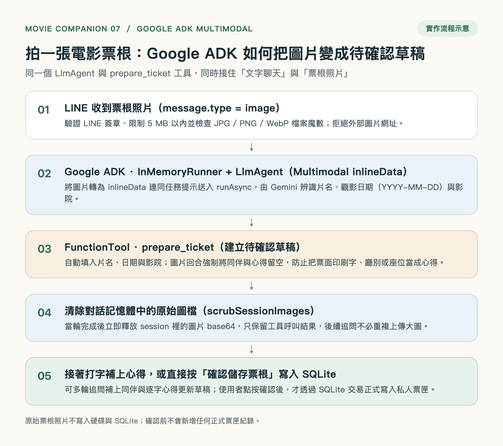
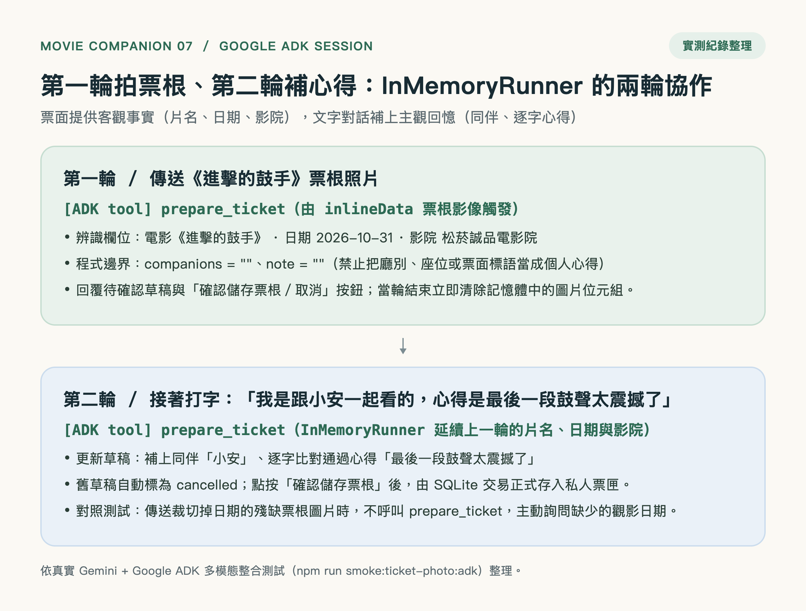
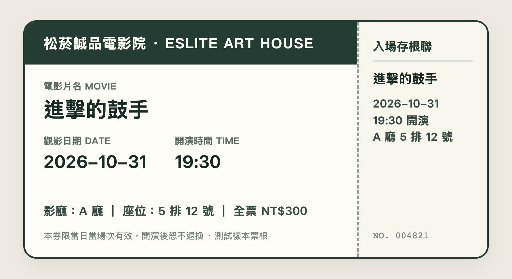
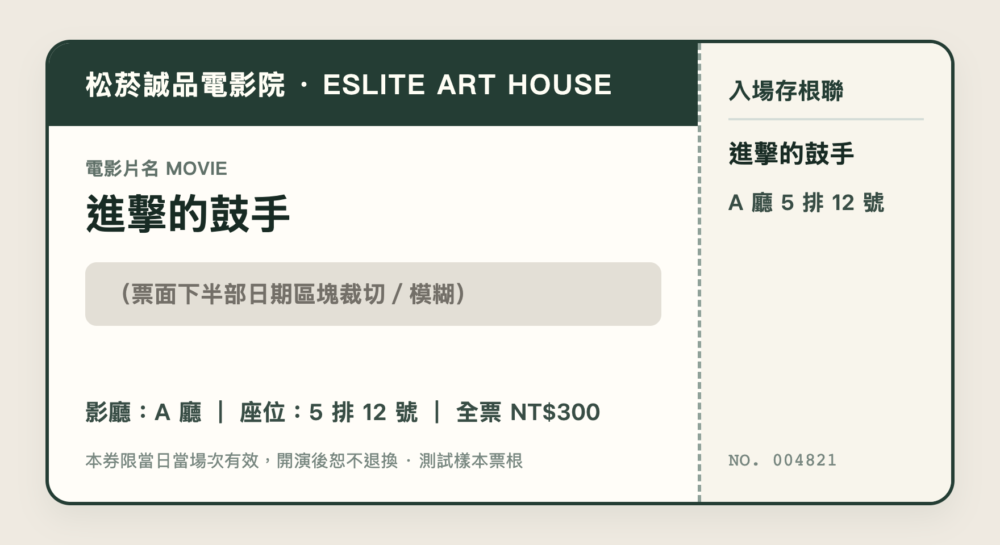

# 電影夥伴 Bot 07：Google ADK 多模態票根拍照辨識 × 待確認草稿

看完電影走出戲院，直接用 LINE 拍一張紙本電影票根或電子票截圖傳給機器人，**Google ADK (`@google/adk`)** 的 `LlmAgent` 就會讀取圖片上的**片名**、**觀影日期（`YYYY-MM-DD`）**與**影院名稱**，自動呼叫既有的 `prepare_ticket` 工具建立待確認草稿，並附上「確認儲存票根／取消」按鈕。



- **同一個 Google ADK Agent 接住「文字」與「圖片」**：沿用 `@google/adk` 的 `LlmAgent`、`FunctionTool` 與 `InMemoryRunner`，將 LINE 圖片轉為 `inlineData` 送入 `runner.runAsync`，與文字記票共用同一顆 `prepare_ticket` 工具與 SQLite 草稿流程。
- **第一輪拍票根、第二輪打字補同伴與心得**：票根提供客觀事實（片名、日期、影院），使用者接著在同一段對話打字說「我是跟小安一起看的，心得是最後一段鼓聲太震撼了」，`InMemoryRunner` 會沿用上一輪脈絡更新草稿，並做逐字心得校驗。
- **嚴格防止票面印刷字污染私人心得**：圖片回合強制將 `companions` 與 `note` 設為空字串，不會把廳別、座位、票種或「本券限當日當場次有效」當成個人觀影心得。
- **缺漏欄位不猜測、確認前不入庫**：若票根照片裁切掉日期或片名模糊，`LlmAgent` 不會硬猜或亂呼叫 `prepare_ticket`，而是主動詢問缺少的欄位；點按「確認儲存票根」前，SQLite 正式票匣不會新增任何紀錄。
- **圖片安全下載與記憶體即時清理**：僅讀取 LINE 託管圖片（拒絕外部網址防 SSRF）、限制 `5 MB` 上限並以檔案魔數檢查 `JPG / PNG / WebP`；當輪結束立即清除 `InMemoryRunner` 對話記憶體中的原始圖片 Base64。



### 內建測試票根樣本

| 完整票根樣本（[`assets/sample-ticket.png`](assets/sample-ticket.png)） | 裁切日期對照樣本（[`assets/sample-ticket-missing-date.png`](assets/sample-ticket-missing-date.png)） |
| --- | --- |
|  |  |

---

## Google ADK 在哪裡？

1. **多模態輸入（`inlineData`）**：在 [`src/agent.mjs`](src/agent.mjs) 中，當 `MovieCompanion.respond` 收到驗證通過的票根圖片時，會組成 `[{ inlineData: { mimeType, data } }, { text: ticketPhotoPrompt }]` 送入 `InMemoryRunner.runAsync`。
2. **共用工具護欄（`prepare_ticket` `FunctionTool`）**：圖片辨識不是繞過 Agent 偷塞資料庫的旁門左道，而是由 `LlmAgent` 萃取欄位後呼叫 `prepare_ticket`。程式在圖片回合（`turn.imageTurn = true`）強制清空 `companions` 與 `note`，再交給 `store.saveDraft` 建立 10 分鐘有效的待確認草稿。
3. **跨回合記憶與圖檔釋放（`scrubSessionImages`）**：當輪完成後，[`src/ticket-photo.mjs`](src/ticket-photo.mjs) 的 `scrubSessionImages` 立即將 `InMemoryRunner` 事件中的圖片位元組替換為文字標記，保留 `prepare_ticket` 的工具呼叫紀錄，讓下一輪文字追問能無縫補上同伴與逐字心得。

詳細設計與安全邊界請見 **[票根拍照辨識技術文件](docs/ticket-photo.md)** 與 **[Medium 專文（`medium.md`）](medium.md)**。

---

## 既有功能完整保留（Bot 01 ～ Bot 06）

- **Bot 06 LINE Flex Message 橫向電影卡片**：詢問「誠品現在有哪些電影好看？」時，以實際影城場次產生可左右滑動的電影卡片與「電影介紹／完整場次／下一批電影」按鈕（詳見 [`docs/flex-message.md`](docs/flex-message.md)）。
- **Bot 05 LINE Rich Menu 四格圖文選單**：底部常駐「電影查詢、我的票匣、附近影院、幫我挑電影」（詳見 [`docs/richmenu.md`](docs/richmenu.md)）。
- **Bot 04 LINE MINI App / LIFF 私人票匣**：點開即看已確認儲存的票根收藏與編輯心得（詳見 [`docs/liff-setup.md`](docs/liff-setup.md)）。
- **Bot 01 ～ 03 全台影城時刻表、Google Maps 附近影院與 SQLite 待確認票根草稿**。

---

## 開發與驗證

Node.js 24.13+、npm 11.8+：

```sh
npm ci --ignore-scripts
npm test
```

### 終端機互動測試（支援 `/photo` 傳送票根圖片）

```sh
npm run chat
# 在互動提示字元輸入：
# /photo assets/sample-ticket.png
# 接著輸入：
# 我是跟小安一起看的，心得是最後一段鼓聲太震撼了
```

### 真實 Gemini + Google ADK 多模態票根冒煙測試

設定 `.env`（包含 `GEMINI_API_KEY`）後，執行：

```sh
npm run smoke:ticket-photo:adk
```

此測試使用記憶體內 SQLite 與內建的 [`assets/sample-ticket.png`](assets/sample-ticket.png)、[`assets/sample-ticket-missing-date.png`](assets/sample-ticket-missing-date.png)，實測驗證：
1. 完整票根圖片觸發 `prepare_ticket` 並正確取出《進擊的鼓手》、`2026-10-31`、松菸誠品電影院，且 `companions` 與 `note` 皆為空字串。
2. 當輪結束後，`InMemoryRunner` 記憶體中的 `inlineData` 圖片位元組已清除為 `0`。
3. 同一段 Session 接著輸入文字「我是跟小安一起看的，心得是最後一段鼓聲太震撼了」，成功更新草稿並通過逐字心得校驗。
4. 缺少日期的票根圖片不會觸發 `prepare_ticket`，而是主動詢問缺少的觀影日期。

大巨蛋秀泰當日晚間場次來源與驗證，見 [大巨蛋場次恢復](docs/dome-recovery.md)。
