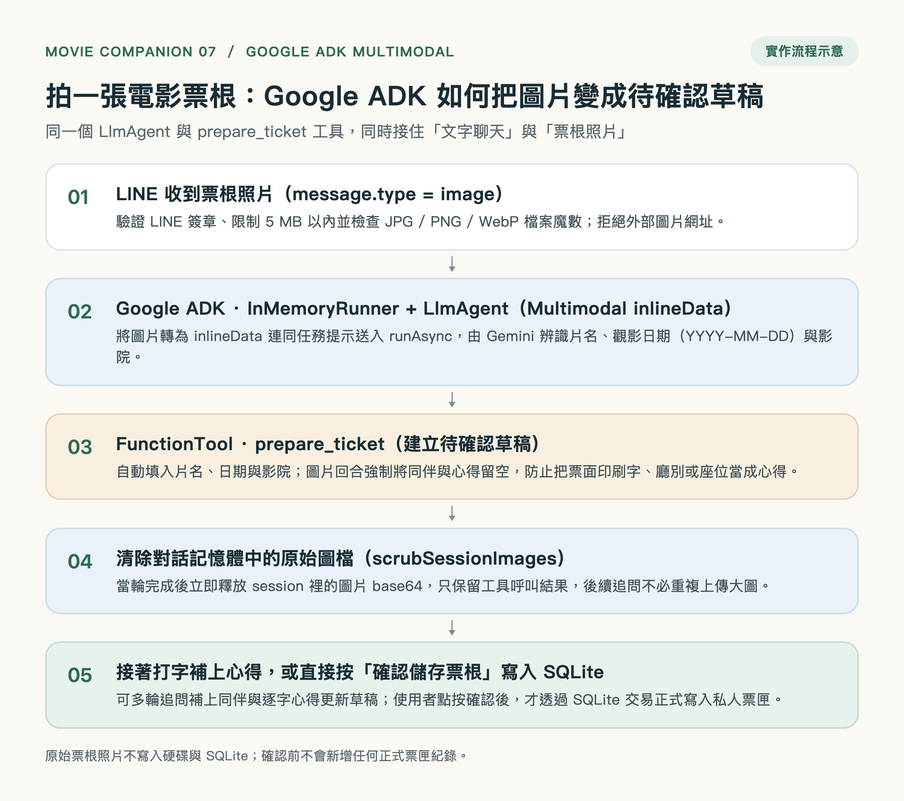
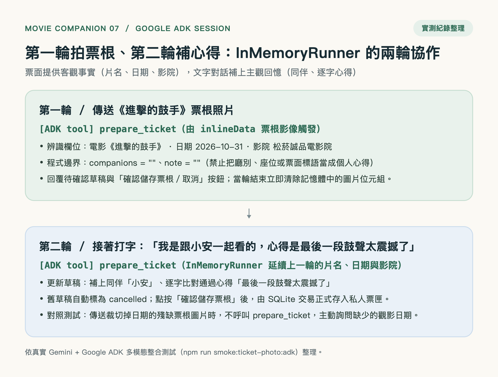

# 票根拍照辨識 × Google ADK 多模態草稿確認技術說明（Bot 07）

本文件說明 `movie-companion-bot-07` 如何在既有「文字對話 + 台灣影城時刻表 + 私人票匣 + LINE Rich Menu / Flex Message」基礎上，加入 **LINE 票根拍照辨識（Multimodal Ticket Photo Recognition）**，並交由同一個 **Google ADK `LlmAgent`** 與 `prepare_ticket` 工具建立待確認草稿。



---

## 1. 為什麼用 Google ADK 多模態做「拍票根存草稿」？

看完電影走出戲院時，使用者手上通常就拿著紙本票根或電子票截圖。若要手動輸入片名、`YYYY-MM-DD` 日期與影院名稱，操作門檻較高；但若只接一套獨立的傳統 OCR 腳本直接寫入資料庫，又會產生三個問題：

1. **辨識錯字直接污染收藏**：票面反光、裁切或字體特殊時，未經確認直接寫入 SQLite 會留下錯誤紀錄。
2. **印刷字樣被誤當成個人心得**：票面上的「本券限當日當場次有效」、「A 廳 5 排 12 號」、「全票 NT$300」不應混入使用者的私人觀影筆記。
3. **無法在同一段對話自然補齊主觀記憶**：票根上只有客觀事實（片名、日期、影院），沒有「跟誰一起看」與「看完的心得」。

在 `movie-companion-bot-07` 中，我們不另起一套獨立 OCR 流程，而是直接運用 **Google ADK (`@google/adk`)** 的三個核心特性：

- **`InMemoryRunner.runAsync` 多模態輸入**：將 LINE 圖片轉為 `{ inlineData: { mimeType, data } }` 連同任務提示送入同一個 `LlmAgent`。
- **共用 `FunctionTool`（`prepare_ticket`）**：無論使用者是打字說「我昨天看了《進擊的鼓手》」還是直接傳一張票根照片，最終都匯流到同一顆 `prepare_ticket` 工具，產出 10 分鐘有效的待確認草稿與 LINE 確認按鈕。
- **跨回合 Session 記憶與即時圖檔清理**：第一輪拍票根建立草稿後，`scrubSessionImages` 會立即清除 `InMemoryRunner` 對話事件中的原始圖片 Base64，僅保留工具呼叫紀錄；使用者第二輪接著打字說「我是跟小安一起看的，心得是最後一段鼓聲太震撼了」，`LlmAgent` 就能沿用上一輪的片名、日期與影院，更新草稿並通過逐字心得校驗。



---

## 2. 系統架構與檔案分工

| 檔案 | 角色與職責 |
| --- | --- |
| [`src/ticket-photo.mjs`](../src/ticket-photo.mjs) | 定義圖片大小上限（`MAX_IMAGE_BYTES = 5 MB`）、允許格式（`JPG / PNG / WebP`）、檔案魔數檢查（`detectImageMimeType` / `validImagePart`）、LINE 圖片下載（`fetchLineImage`）、多模態提示（`ticketPhotoPrompt`）與對話記憶體圖片清理（`scrubSessionImages`）。 |
| [`src/line.mjs`](../src/line.mjs) | `parseEvents` 支援一對一 `message.type === 'image'`（僅接受 LINE 託管圖片，忽略 `contentProvider.type === 'external'` 外部網址避免 SSRF）。 |
| [`src/app.mjs`](../src/app.mjs) | Webhook 收到圖片事件時，先透過 `fetchImage` 安全讀取圖片位元組，成功後呼叫 `bot.respond(actor, ticketPhotoPrompt, job.id, { image })`。 |
| [`src/agent.mjs`](../src/agent.mjs) | `MovieCompanion.respond` 支援 `context.image`；在圖片回合（`turn.imageTurn = true`）強制將 `prepare_ticket` 的 `companions` 與 `note` 設為空字串，並在當輪結束後呼叫 `scrubSessionImages`。 |
| [`src/cli.mjs`](../src/cli.mjs) | 終端機互動模式新增 `/photo <圖片路徑>` 指令，方便在本機直接拿票根圖片測試 Google ADK 多模態辨識。 |
| [`assets/sample-ticket.png`](../assets/sample-ticket.png) | 內建完整票根測試樣本（《進擊的鼓手》、`2026-10-31`、松菸誠品電影院）。 |
| [`assets/sample-ticket-missing-date.png`](../assets/sample-ticket-missing-date.png) | 內建缺少日期的票根測試樣本，驗證模型在資訊不足時不會硬猜或亂呼叫 `prepare_ticket`。 |

---

## 3. 四道安全與資料邊界

1. **LINE 圖片下載與格式防護（防 SSRF / 防超大檔）**
   - 僅向 `https://api-data.line.me/v2/bot/message/:id/content` 下載圖片，`messageId` 必須符合 `/^[A-Za-z0-9_-]{1,120}$/`，且 `redirect: 'error'` 禁止重導向。
   - 串流讀取超過 `5 MB` 立即中斷並回傳友善提示。
   - 以檔案開頭魔數（Magic Bytes）實測驗證 `image/jpeg`、`image/png`、`image/webp`，不單靠 HTTP Header。
2. **圖片回合禁止寫入心得（防票面印刷字污染）**
   - 在 `src/agent.mjs` 中，當 `context.image` 存在時，`turn.originals` 保持為空陣列，且 `prepare_ticket` 在 `turn.imageTurn` 為真時強制將 `companions` 與 `note` 設為 `""`。
   - 即使票面上印有廳別、座位、票種或宣傳標語，也絕不會被塞進私人心得欄位。
3. **缺漏欄位不猜測、確認前不入庫**
   - 若票根照片裁切掉觀影日期或片名無法辨識，`LlmAgent` 不會呼叫 `prepare_ticket`，而是直接回覆目前已辨識到的欄位並詢問缺少的資訊。
   - 即使成功建立草稿，在點按「確認儲存票根」前，SQLite 的 `tickets` 正式表不會新增任何紀錄。
4. **原始照片不落盤、當輪結束立即從 ADK Session 清除**
   - 票根圖片僅在當次請求記憶體中轉為 `inlineData` 送交 Gemini，不寫入本機硬碟與 SQLite。
   - 當輪 `runner.runAsync` 完成後，`scrubSessionImages` 立即將 `InMemoryRunner` 歷史事件中的 `inlineData` 替換為純文字標記，避免後續多輪對話重複傳送數 MB 的 Base64 影像。

---

## 4. 驗證方式與實測結果

### 單元與整合測試（含 Mock 多模態 LlmAgent）

```bash
npm test
```

- 共 **127 項測試全數通過**，涵蓋 `test/ticket-photo.test.mjs` 中的圖片魔數檢查、5 MB 串流上限、外部圖片過濾、圖片回合強制清空 `companions/note`、`scrubSessionImages` 記憶體清理，以及「第一輪傳圖、第二輪打字補同伴與心得」完整雙輪流程。

### 真實 Gemini + Google ADK 多模態冒煙測試

```bash
npm run smoke:ticket-photo:adk
```

- 實測使用 `assets/sample-ticket.png` 送入真實 Gemini 與 Google ADK `InMemoryRunner`：
  1. **第一輪（票根照片）**：成功觸發 `prepare_ticket`，辨識出 `movieTitle: "進擊的鼓手"`、`watchedOn: "2026-10-31"`、`cinema: "松菸誠品電影院"`，且 `companions: ""`、`note: ""`，對話記憶體中的 `inlineData` 數量歸零。
  2. **第二輪（同 Session 文字追問）**：輸入「我是跟小安一起看的，心得是最後一段鼓聲太震撼了」，成功再次觸發 `prepare_ticket`，保留上一輪片名、日期與影院，並更新 `companions: "小安"`、`note: "最後一段鼓聲太震撼了"`，點按確認後正式寫入 SQLite。
  3. **對照組（缺少日期的票根照片 `assets/sample-ticket-missing-date.png`）**：模型不呼叫 `prepare_ticket`，並主動詢問缺少的觀影日期。
