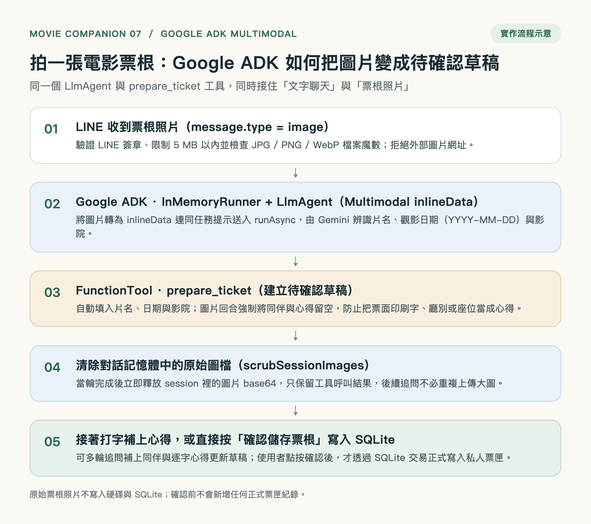
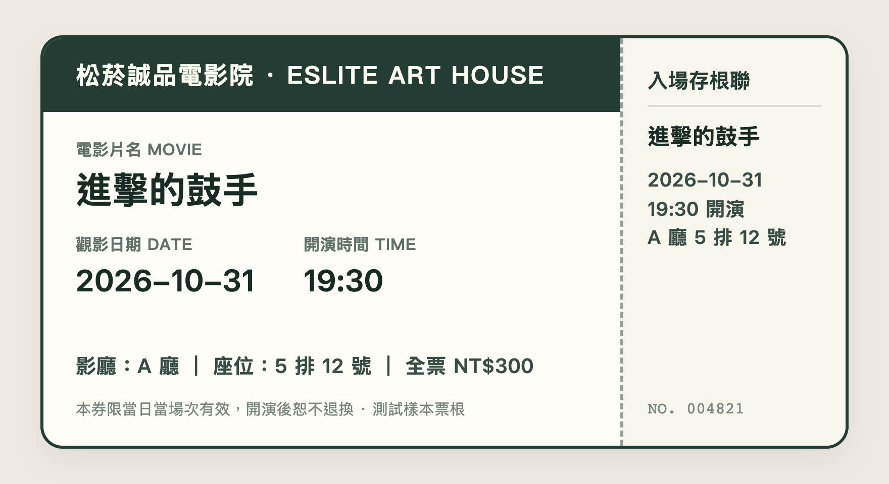
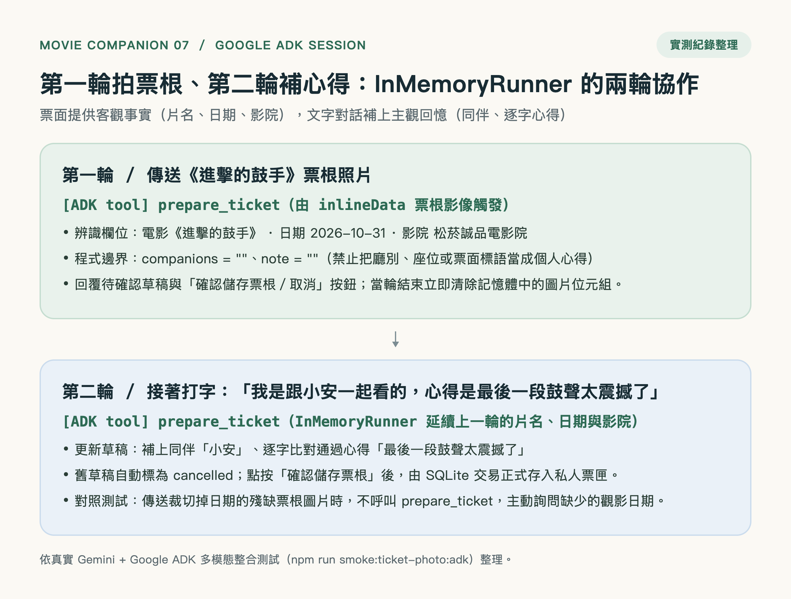

# 散場後拍一張電影票根：用 Google ADK 多模態把 LINE 照片變成待確認的觀影草稿

[上一篇](https://github.com/zonawang/movie-companion-bot-06-flex-message/blob/main/medium.md)，我用 Google ADK 搭配 LINE Flex Message，把原本一長串的影城場次整理成可以左右滑動、點看介紹與換批瀏覽的電影卡片，同時也補齊了松菸誠品與大巨蛋秀泰等影城的場次來源備援。

挑選電影與查場次的畫面變好讀之後，我回頭注意到散場後的另一個使用情境。

剛從電影院走出來、手裡還拿著紙本票根或手機購票截圖的時候，其實就是最想把這場電影收進票匣的瞬間。

但在這個瞬間，如果要打開鍵盤、一個字一個字輸入片名、把日期換算成 `YYYY-MM-DD`、再打上完整的影院名稱，很多人走進捷運站之前就懶得記了。

這篇記錄 Bot 07 完成的部分：**沿用同一個 Google ADK 架構，接住 LINE 傳來的電影票根照片，透過多模態輸入辨識片名、觀影日期與影院，自動呼叫既有的 `prepare_ticket` 工具建立待確認草稿，並支援接著用文字補上同伴與個人心得。**



---

## 為什麼不另外接一套傳統 OCR，而是直接交給 Google ADK？

一想到「拍票根存紀錄」，最直覺的做法往往是在對話流程外面另外接一套獨立的 OCR 文字辨識服務，讀出文字後直接塞進資料庫。

但實際拿電影票根思考整個流程，就會發現三個問題：

1. **每家戲院的票根排版都不一樣**：有的把年份印在斜線後面，有的同時印了中英文片名、廳別與分級標示，單靠固定座標或正則規則很容易抓錯欄位。
2. **辨識錯字不能直接寫進正式收藏**：票面反光、折痕或陰影都可能造成辨識誤差；如果沒經過使用者確認就直接寫進 SQLite，私人票匣很快就會出現錯誤紀錄。
3. **票根照片上只有「客觀事實」，沒有「主觀記憶」**：票根上印著片名、日期與戲院，但不會印你是跟哪位朋友一起看的，也不會印你散場時心裡那句最真實的感想。

這正是 **Google ADK（Agent Development Kit）** 最能發揮價值的地方。

在 Google ADK 的架構裡，我們不需要為了「拍照記票」另外造一條繞過 Agent 的旁門左道。

我們可以直接把票根圖片轉成多模態輸入（`inlineData`），送進原本就負責管家的 **`LlmAgent`** 與 **`InMemoryRunner`**，讓它去呼叫同一顆 **`prepare_ticket`（`FunctionTool`）**。

```text
使用者在 LINE 傳送電影票根照片
        ↓
Webhook 驗簽、檢查 5 MB 上限與 JPG/PNG/WebP 檔案魔數
        ↓
Google ADK InMemoryRunner 送入 inlineData 圖片與辨識提示
        ↓
LlmAgent 讀出片名、日期、影院 → 呼叫 prepare_ticket 工具
        ↓
建立 10 分鐘待確認草稿（同伴與心得強制留空）並清除對話記憶體中的大圖
        ↓
使用者直接點「確認儲存票根」，或接著打字補上同伴與心得
```

這樣一來，無論使用者是「打字記票」還是「拍票根記票」，最後都會走進同一套「先建草稿、按鈕確認後才寫入 SQLite」的安全流程。

---

## 把票根照片放進 Google ADK，清楚切開每個欄位的責任

為了讓 Google ADK 讀懂票根、卻又不會把票面雜訊當成個人筆記，我把圖片辨識時每個欄位的處理方式收斂成這張表：

| 票根草稿欄位 | 拍照回合（Image Turn）的處理方式 | 為什麼這樣設計 |
| --- | --- | --- |
| 電影名稱（`movieTitle`） | 由 Google ADK 從票面清楚可見的文字提取 | 省去手動打字，特別是片名很長的時候 |
| 觀影日期（`watchedOn`） | 由 Google ADK 轉為 `YYYY-MM-DD`；若缺少年份或日期則不呼叫工具 | 確保日期格式一致，看不清楚時不亂猜今天 |
| 影院名稱（`cinema`） | 提取票面上的戲院或影城名稱；看不出來則留空 | 自動記下是在哪間戲院看的 |
| 同伴（`companions`） | **程式強制鎖定為空字串** | 票根上不會印同行朋友，留給後續文字補充 |
| 個人心得（`note`） | **程式強制鎖定為空字串** | 防止把廳別、座位或票面標語當成私人心得 |

我們拿專案內建的《進擊的鼓手》測試票根來實際跑一次：



當這張圖片透過 `InMemoryRunner.runAsync` 送進 Google ADK 後，`LlmAgent` 會直接讀出：

- **電影**：`進擊的鼓手`
- **日期**：`2026-10-31`
- **影院**：`松菸誠品電影院`

接著自動觸發 `prepare_ticket`，在 LINE 聊天室回傳待確認草稿與「確認儲存票根／取消」按鈕。

---

## `FunctionTool` 的邊界：不把票面印刷字當成你的心得，看不清楚也不硬猜

做票根圖片辨識時，很容易遇到兩個邊界狀況。

第一個狀況，是電影票根上除了片名、日期和戲院，還印了非常多額外文字。

例如「A 廳 5 排 12 號」、「全票 NT$300」、「入場存根聯」，或是底下的「本券限當日當場次有效，開演後恕不退換」。

如果只靠提示詞叮囑模型，模型偶爾還是會「太熱心」，把廳別、座位號碼或票面警語塞進 `note`（個人心得）欄位裡。

為了守住私人收藏的乾淨度，我們直接在 **Google ADK 的 `prepare_ticket` 工具層**加上硬性規則：

> **只要當輪輸入是票根圖片，程式就會強制把 `companions`（同伴）與 `note`（個人心得）重設為空字串。**

也就是說，圖片回合唯一允許模型填入的，只有票面上看得見的客觀資訊（片名、日期、影院）。就算票面上印了再多標語或座位資訊，也絕對不可能溜進你的私人心得欄位。

第二個狀況，是如果使用者拍到的票根切掉了下半部的日期，或是反光看不清楚怎麼辦？

我們另外準備了一張裁切掉日期區塊的對照票根（`assets/sample-ticket-missing-date.png`）做測試。

當圖片上看不到完整的西元觀影日期時，Google ADK 的 `LlmAgent` **不會硬猜今天日期，也不會呼叫 `prepare_ticket`**，而是老實回覆使用者：

> 「這張圖片上可以看到片名是《進擊的鼓手》、影院是松菸誠品電影院，但缺少完整的觀影日期。請補充觀影日期（例如 `YYYY-MM-DD`），我再幫你建立票根草稿！」

---

## 第一輪拍票根、第二輪打字補心得：`InMemoryRunner` 的兩輪協作

在 LINE 真機上測試時，我自己最喜歡的是「先拍照、再補一句話」的兩輪互動。

當你第一輪傳送票根照片，Google ADK 幫你建好包含片名、日期、影院的草稿後，如果你這時候想把同伴跟剛看完的感想一起記下來，你完全不需要重頭再打一次片名跟日期。

你只要接著在 LINE 聊天室打一句話：

> **我是跟小安一起看的，心得是最後一段鼓聲太震撼了**

因為 **Google ADK 的 `InMemoryRunner`** 保存了這段對話的工具呼叫脈絡，`LlmAgent` 馬上就知道這句話是在補充剛剛那張《進擊的鼓手》票根。

它會自動沿用第一輪辨識出的片名 `進擊的鼓手`、日期 `2026-10-31` 與影院 `松菸誠品電影院`，並把同伴更新為 `小安`、把心得更新為 `最後一段鼓聲太震撼了`，再次呼叫 `prepare_ticket` 換發一張完整的待確認草稿。

而且在這個第二輪文字回合中，我們原有的「心得必須是使用者原話子字串」程式校驗依然完全生效——模型連一個標點符號都不能幫你改寫。



---

## 讀完就清掉記憶體裡的大圖：讓多輪對話保持輕快

把圖片送進 `InMemoryRunner` 還有一個實務細節要處理。

使用者隨手拍的票根照片，動輒就是 1 到 3 MB 的圖檔。如果這串 Base64 圖片資料一直留在 `InMemoryRunner` 的對話歷史事件（Session Events）裡，那使用者後面每聊一句話，就等於要把這張大圖重新上傳給模型一次，既拖慢速度又佔記憶體。

因此，我們在 [`src/ticket-photo.mjs`](https://github.com/zonawang/movie-companion-bot-07/blob/main/src/ticket-photo.mjs) 裡實作了 `scrubSessionImages`：

- 當圖片回合的 `runner.runAsync` 一結束，程式會立刻巡檢當前 Session 的歷史事件，把 `inlineData` 原始圖片位元組替換成一句輕量的文字標記。
- 同時保留 `prepare_ticket` 的工具呼叫結果，讓下一輪文字追問依然看得到剛剛辨識出的片名、日期與影院。
- 原始票根圖片既不寫入硬碟、也不寫進 SQLite，讀完即釋放。

---

## 這次驗證到哪裡

完成票根拍照辨識並合併大巨蛋秀泰場次恢復後，全專案自動測試來到 **133 項，全部通過**。

除了單元測試與內建的 `npm run smoke:ticket-photo:adk` 真實模型冒煙測試外，我們也將 Bot 07 部署上 Google Compute Engine 正式機，直接在手機 LINE 的 **Zona Movie（`@796qcwyz`）** 聊天室完成真人實測：

```text
Oct 31 10:17:45 movie-bot-03: Sending out request, model: gemini-3.5-flash-lite
Oct 31 10:17:47 movie-bot-03: [ADK tool] prepare_ticket
Oct 31 10:18:32 movie-bot-03: Sending out request, model: gemini-3.5-flash-lite
Oct 31 10:18:33 movie-bot-03: [ADK tool] prepare_ticket
```

從雲端日誌可以清楚看到：第一輪傳送票根照片約 2 秒即觸發 `prepare_ticket` 回傳草稿；接著用文字補上同伴與心得，約 1 秒即完成第二次 `prepare_ticket` 草稿更新。

| 驗證項目 | 這次確認的內容 |
| --- | --- |
| LINE 圖片下載與格式防護 | 僅讀取 LINE 託管圖片（拒絕外部網址）、限制 5 MB 上限、以檔案魔數驗證 JPG / PNG / WebP |
| Google ADK 多模態辨識 | 真實 Gemini + `InMemoryRunner` 從票根照片讀出片名、`YYYY-MM-DD` 日期與影院並呼叫 `prepare_ticket` |
| 印刷字污染防護 | 圖片回合強制將 `companions` 與 `note` 設為空字串，廳別、座位與票面警語不會混入私人心得 |
| 殘缺票根防呆 | 傳送裁切掉日期的票根圖片時，不呼叫 `prepare_ticket`，主動詢問缺少的觀影日期 |
| 兩輪協作與逐字心得 | 第一輪傳圖、第二輪打字補同伴與心得可無縫更新草稿，且保留逐字心得比對與舊草稿自動取消 |
| 記憶體圖片清理 | 當輪結束後 Session 內 `inlineData` 數量歸零，不落地儲存原始票根照片 |
| 原有功能與場次恢復 | Flex Message 電影卡片、Rich Menu、Published MINI App 票匣與大巨蛋秀泰場次恢復全數相容通過 |

---

## 小結：讓 Google ADK 成為多模態輸入與資料庫之間的守門人

回頭看這七個階段的演進，從最基礎的文字對話、全台影城時刻表、Google Maps 附近戲院、LIFF 私人票匣、Rich Menu、Flex Message 電影卡片，到現在支援**拍票根直接建草稿**，我們其實從頭到尾都圍繞著同一個核心原則：

> **把「理解圖片與自然語言的彈性」交給 Google ADK 的 `LlmAgent`，把「資料正確性與寫入邊界」交給 `FunctionTool` 與 SQLite 確認機制。**

當你散場走出戲院，隨手拍下票根、補上一句跟誰看與當下的感動、再按下「確認儲存票根」，一張乾淨、真實、不會被 AI 亂改半個字的觀影記憶，就安安靜靜地收進你的私人票匣裡了。

---

## 完整程式碼與參考資料

- [這次的電影夥伴專案：movie-companion-bot-07](https://github.com/zonawang/movie-companion-bot-07)
- [上一篇｜從一長串場次，到一張張電影卡片：用 Google ADK 與 LINE Flex Message，讓電影夥伴更好讀](https://github.com/zonawang/movie-companion-bot-06-flex-message/blob/main/medium.md)
- [Zona Movie LINE 入口](https://line.me/R/ti/p/@796qcwyz)
- [正式票匣（LINE MINI App）](https://miniapp.line.me/2012222034-AVyO2nk3)
- [票根圖片驗證與記憶體清理：`src/ticket-photo.mjs`](https://github.com/zonawang/movie-companion-bot-07/blob/main/src/ticket-photo.mjs)
- [Google ADK 多模態與工具護欄：`src/agent.mjs`](https://github.com/zonawang/movie-companion-bot-07/blob/main/src/agent.mjs)
- [票根拍照辨識技術說明：`docs/ticket-photo.md`](https://github.com/zonawang/movie-companion-bot-07/blob/main/docs/ticket-photo.md)
- [大巨蛋場次恢復說明：`docs/dome-recovery.md`](https://github.com/zonawang/movie-companion-bot-07/blob/main/docs/dome-recovery.md)
